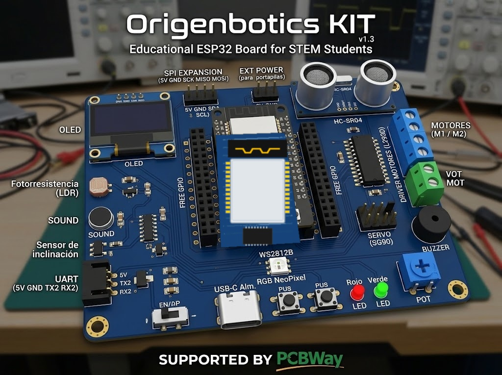
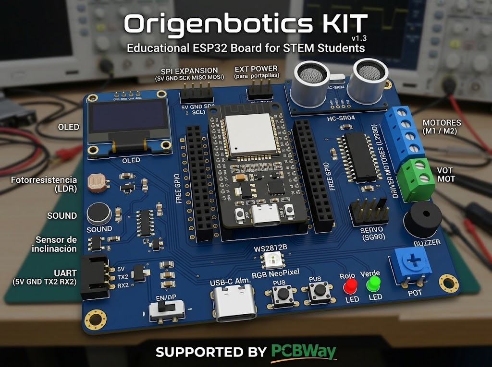
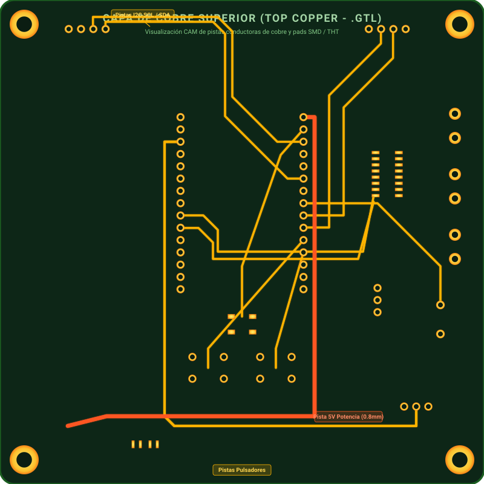

# ChamoMaker v1.0 — Placa Educativa Todo-en-Uno (ESP32 STEM)

[](https://cern.ch/cern-ohl)
[](https://www.pcbway.com)
[](https://infocentroaguascalientes.com/autana/)
[](https://www.tiktok.com/@origenbotics)
[](https://www.tiktok.com/@origenbotics)
[](https://espressif.com)

**ChamoMaker** es una placa base de desarrollo y robótica educativa basada en el microcontrolador **ESP32 (NodeMCU 30 pines)**, creada específicamente para eliminar la barrera del "cableado espagueti" y protoboards gastados en talleres escolares de ciencia, tecnología, ingeniería y matemáticas (STEM).

Diseñada en Venezuela por el facilitador **Ismael Rodríguez (la comunidad Origenbotics)** para donación en escuelas públicas y laboratorios comunitarios, con el respaldo y patrocinio de fabricación de **PCBWay**.

---

## 📸 Renders e Inspección de Pistas de Cobre

| Origenbotics KIT v2.0 SMT (ESP32 Soldado) | Render de Referencia | Enrutado Top Copper (.GTL) |
| :---: | :---: | :---: |
|  |  |  |

---

## 🎯 El Problema Educativo y la Solución

### El Desafío en el Aula:
En escuelas públicas y centros comunitarios, los talleres introductorios de robótica con protoboards tradicionales sufren de:
- **Cables jumper que se quiebran internamente:** Los estudiantes pasan el 70% del tiempo buscando qué cable hace falso contacto en lugar de comprender la lógica de programación.
- **Riesgo eléctrico:** Conexiones accidentales de 5V directos en pines no tolerantes del microcontrolador.
- **Desgaste mecánico acelerado:** Las protoboards pierden presión en sus pistas internas tras pocos meses de uso rudo escolar.

### La Solución ChamoMaker:
Una **placa base robusta y unificada de 10 cm × 10 cm** donde todos los periféricos clave se conectan mediante **zócalos hembra dedicados y seguros (Plug & Play)**, con protecciones de hardware integradas.

---

## 🧩 Características y Módulos Integrados

1. **Cerebro / Microcontrolador:**
   - Zócalo hembra de paso 2.54 mm para módulo **ESP32 NodeMCU 30 pines** (fácil de retirar, sustituir o reutilizar).
2. **Visualización en Vivo:**
   - Zócalo hembra de 4 pines I2C para pantalla **OLED 0.96" SSD1306 (128×64)**.
3. **Sensor de Proximidad / Radar:**
   - Zócalo hembra de 4 pines para sensor ultrasónico **HC-SR04**, equipado con un **divisor resistivo integrado (1kΩ / 2kΩ)** que reduce los 5V de retorno del pin `ECHO` a 3.3V seguros para el ESP32.
4. **Control de Motores DC (Tracción de Carritos):**
   - Circuito integrado de puente H doble **MX1508 / TC1508S** (alta eficiencia MOSFET, sin caídas térmicas de los drivers antiguos).
   - Borneras de tornillo de 5.08 mm para **Motor 1 (M1)** y **Motor 2 (M2)**.
   - Bornera dedicada **VMOT (3V - 9V)** para alimentar motores de forma independiente sin reiniciar el microcontrolador.
5. **Movimiento Angular:**
   - Tira macho de 3 pines estándar (`GND`, `5V`, `SIG/PWM GPIO4`) para servomotores tipo **SG90 / MG90S**.
6. **Sensores Analógicos y Digitales Integrados:**
   - **Fotorresistencia (LDR):** En `GPIO 34` (Canal ADC1, sin conflicto con Wi-Fi) para proyectos de domótica y seguidores de luz.
   - **Sensor de Sonido / Micrófono:** En `GPIO 35` para detección de aplausos y umbrales de ruido.
   - **Sensor de Inclinación / Vibración (SW-520D):** En `GPIO 33` para detectar volcamientos del robot.
   - **Potenciómetro Analógico (Trimmer):** En `GPIO 36 (VP)` para control analógico de velocidad, ángulo de servo o contraste.
7. **Actuadores Luminosos y Sonido:**
   - **LED NeoPixel direccionable WS2812B (RGB 5050):** En `GPIO 23` con condensador de desacoplo de 100nF.
   - **LEDs de Estado:** LED Rojo en `GPIO 2` y LED Verde en `GPIO 15`.
   - **Buzzer Piezoeléctrico:** En `GPIO 19` para alertas audibles y melodías.
8. **Entradas de Usuario:**
   - 2 Botones pulsadores táctiles grandes de 6×6 mm en `GPIO 16` y `GPIO 17`.
9. **Alimentación y Seguridad Eléctrica:**
   - Puerto **USB-C** para alimentación desde PC o cargador.
   - Conector tipo **JST-XH de 2 pines** para portapilas (4xAA o Li-Ion 18650).
   - **Diodo Schottky de protección (SS34 - 3A):** Evita corriente inversa si el estudiante conecta USB y baterías al mismo tiempo.
   - Interruptor deslizante mecánico **ON / OFF**.
10. **Puertos de Expansión:**
    - Cabezal **UART2** (5V, GND, TX2, RX2) para módulos Bluetooth, GPS o comunicación interplaca.
    - Cabezal **I2C Expansion** para sensores adicionales (MPU6050, BMP280, etc.).

---

## 📌 Asignación de Pines del ESP32 (Pinout Seguro)

Todos los sensores analógicos se conectaron al bloque **ADC1** del ESP32, garantizando lecturas estables mientras el Wi-Fi y Bluetooth están transmitiendo datos.

```text
                      +-------------------+
                      |   ESP32 DevKit    |
   OLED / 3.3V <----- | 3V3           VIN | <----- 5V (USB-C / Batería)
                      | EN            D23 | -----> NeoPixel RGB (WS2812B)
   POT (Analog) <---- | VP (D36)      D22 | -----> OLED SCL & I2C EXP
                      | VN (D39)      TX0 | -----> Serial Flashing TX
   LDR (Luz) <------- | D34           RX0 | -----> Serial Flashing RX
   MIC (Sonido) <---- | D35           D21 | -----> OLED SDA & I2C EXP
                      | D32           GND | ------ Masa común (GND)
   TILT (Vib.) <----- | D33           D19 | -----> Buzzer piezoeléctrico
   Motor 1 IN1 <----- | D25           D18 | <----- HC-SR04 ECHO (Divisor 1k/2k)
   Motor 1 IN2 <----- | D26            D5 | -----> HC-SR04 TRIG
   Motor 2 IN1 <----- | D27           D17 | <----- Botón 1 (Pulsador SW1)
   Motor 2 IN2 <----- | D14           D16 | <----- Botón 2 (Pulsador SW2)
                      | D12            D4 | -----> Servo SG90 (Señal PWM)
                      | D13            D2 | -----> LED Rojo
                      | GND           D15 | -----> LED Verde
                      +-------------------+
```

---

## 🏭 Especificaciones de Fabricación (DFM / PCBWay)

- **Dimensiones:** 100.0 mm × 100.0 mm (10 cm × 10 cm - Tamaño estándar promocional).
- **Número de Capas:** 2 capas (Cobre superior: señales y potencia; Cobre inferior: plano de masa GND completo).
- **Grosor de PCB:** 1.6 mm estándar FR-4.
- **Color de Máscara:** Azul (Blue Solder Mask) con serigrafía blanca (White Silkscreen).
- **Ancho de pistas mínimas:** 0.30 mm (Señales), 0.80 mm - 1.2 mm (Líneas de potencia 5V y GND).
- **Aislamiento (Clearance):** 0.20 mm.
- **Fijación:** 4 orificios de montaje en las esquinas para tornillería M3 (3.2 mm) con anillo de conexión a tierra.
- **Ensamblaje SMT:** **100% de los componentes montados en la cara superior (Top Side)** para optimizar los costos de máquina de PCBWay.

---

## 📁 Archivos Disponibles en este Repositorio

- **`ChamoMaker_Gerber.zip`**: Paquete maestro Gerber RS-274X (`.GTL`, `.GBL`, `.GTS`, `.GBS`, `.GTO`, `.GBO`, `.GKO`) y taladro Excellon (`.DRL`).
- **`ChamoMaker_BOM.csv`**: Lista de componentes (*Bill of Materials*) con números de parte LCSC/PCBWay estandarizados.
- **`ChamoMaker_CPL.csv`**: Tabla de coordenadas de posición (*Pick & Place / Centroid*) para ensamblaje automatizado.
- **`LICENSE`**: Licencia de Hardware Abierto CERN-OHL-P v2.

---

## 🤝 Patrocinio y Agradecimientos

Este proyecto es de código abierto con fines 100% benéficos para la educación venezolana. Agradecemos a **PCBWay** por su programa de patrocinio comunitario (*Non-profit Project Sponsorship*), haciendo posible la fabricación física de estas placas para nuestros estudiantes.

La serigrafía frontal de la placa incluye el reconocimiento:
**`SUPPORTED BY PCBWay`**

---


---

## 🌐 Enlaces Oficiales y Comunidad

- 🌐 **Plataforma Web del Proyecto:** [infocentroaguascalientes.com/autana](https://infocentroaguascalientes.com/autana/)
- 📱 **TikTok Oficial (Robótica y Talleres):** [@origenbotics](https://www.tiktok.com/@origenbotics)
- 🏛️ **Institución Promotora:** Comunidad Maker Origenbotics (Venezuela)
- 🛠️ **Facilitador / Diseñador:** Ismael Rodríguez

## 📄 Licencia

Este proyecto está bajo la licencia [CERN Open Hardware Licence Version 2 - Permissive (CERN-OHL-P)](LICENSE).
